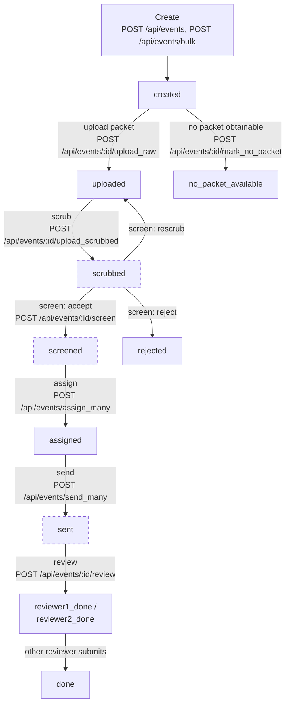
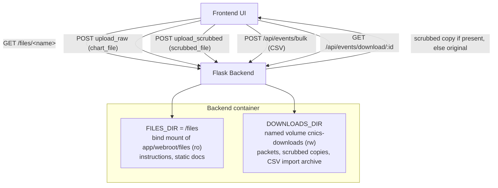

### CNICS Validation – Workflow

This page shows how an event moves through its lifecycle and where its files go.
For who may do each step, see [WORKFLOW_AUTH.md](WORKFLOW_AUTH.md).

## Workflow controls

Not every deployment runs every stage. `STUDY_TYPE` selects a default profile,
and each control can be overridden in `.env` (see `default.env`). The controls are
resolved once at startup by `flask_backend/study_config.py` and served to the
frontend by `GET /api/config`.

| Control            | Full workflow (`mci` and any other study) | `dischargesummaries` | `scans` |
|--------------------|:-----:|:-----:|:-----:|
| `ENABLE_SCRUBBING` | on    | on    | off   |
| `ENABLE_SCREENING` | on    | off   | off   |
| `ENABLE_SENDING`   | on    | off   | off   |
| `REVIEWER_COUNT`   | 2     | 1     | 1     |

A disabled stage is skipped: its status is never entered and its page and menu
items are hidden. See [specs/003-scans-study](../specs/003-scans-study/spec.md) and
[specs/013-dischargesummaries-study](../specs/013-dischargesummaries-study/spec.md).

## Event lifecycle

Stages drawn with dashed borders run only when their control is on.

How the disabled stages collapse:

- **Scrubbing off:** `uploaded` goes straight to screening, or to assignment if screening is also off.
- **Screening off:** the last completed stage (`scrubbed` or `uploaded`) is ready for assignment.
- **Sending off:** an `assigned` event is already in its reviewers' queues.
- **One reviewer:** the single review moves the event straight to `done`.

`table_service.derive_pre_send_status()` turns these rules into a status.
Upload, scrub and screen-accept all set their status through it, and don't
write a fixed value.

### Replacing a packet (spec 014)

An uploader at the event's site, or an admin, may replace an event's packet
until it is released to reviewers. That means until it is sent, or, when
sending is off, until a review is submitted. This is the
**Re-upload Existing Packets** page (`/events/reupload`). A replacement:

- renames the old scrubbed copies to `superseded_<id>_<timestamp><ext>` (they are not deleted);
- clears the scrub and screen dates, so those stages run again;
- keeps the reviewer assignment;
- writes a `logs` row.

Before spec 014, the re-upload list showed only events with status `uploaded`
(packet in, not yet scrubbed). See
[specs/014-packet-replace-review-edit](../specs/014-packet-replace-review-edit/spec.md).

### Editing a submitted review (spec 014)

A reviewer may edit their own review (`PUT /api/events/:id/review`). In a
single-reviewer study this is always allowed. In a two-reviewer study it is
allowed until the other reviewer submits. An edit never changes the event's
status or review dates; it stamps `reviews.modified`.

### Third reviewer (not implemented)

Two reviewers work in parallel. The intended design adds a third reviewer as
a tiebreaker when they disagree. That is **not wired**: nothing compares the
two reviews, nothing sets the `third_review_needed` / `third_review_assigned`
statuses, and `POST /api/events/:id/review` does not accept a slot-3 review.
Some third-reviewer plumbing exists: the `reviewer3_id` column, the
`/events/assignThird` page, the `third_reviewer` user flag, and the slot-3 rule
in `GET /api/reviewer/awaiting`.

### Pre-scrub step (not implemented)

The legacy VTE study had a pre-scrub step before scrubbing (see
[legacy-repository-analysis.md](legacy-repository-analysis.md)). An earlier
version of this page proposed `ENABLE_PRESCRUB` and `PARALLEL_REVIEWS` flags.
Neither exists in the code.

## File flows

- Uploaded packets are saved as `orig_<eventId>_<fileNumber>.<ext>`.
- `GET /api/events/download/:id` serves the scrubbed copy when there is one,
  and otherwise the original. It checks who is asking first (see
  [WORKFLOW_AUTH.md](WORKFLOW_AUTH.md#packet-downloads)).
- CSV bulk imports are archived under `DOWNLOADS_DIR/imports/` with a JSON
  sidecar ([specs/009-save-import-csv](../specs/009-save-import-csv/spec.md)).
- `GET /files/<path>` is public (no sign-in). When a requested `.pdf` is
  missing, it tries to convert a `.docx`/`.doc` of the same name into
  `FILES_DIR`. The PDF can't be written while `FILES_DIR` is mounted
  read-only, so ship PDFs alongside the documents.
